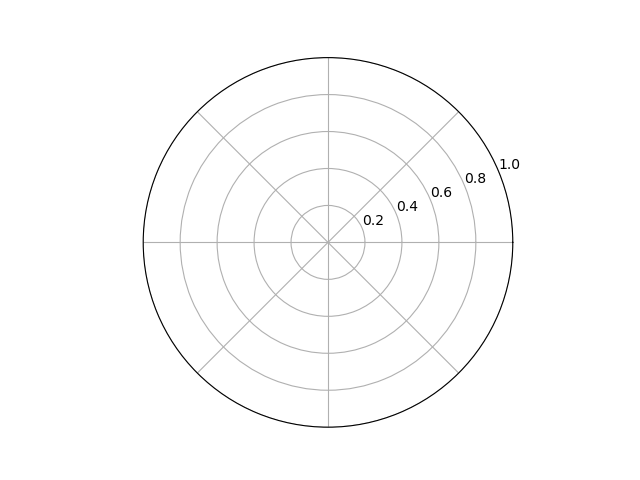

# SHAREing: High-level performance assessment report template

> [!NOTE]
>
> 1. Guidance throughout this template is provided using information boxes, along with example text and placeholders.
     The example text is not meant to be a complete comment, but a suggestion to get you started. Please remove the
     information boxes and replace the example text in your report. Add or remove subheadings per rubric if required for
     any given assessment.
>
> 2. Some equations have extra escape characters (`\`) to enable them to render correctly on GitHub. These might change
     the way the equations render for your Markdown previewer e.g. VS Code. Edit these if required when converting
     reports to PDF.
>
> 3. The template is based on Chapter 5 of
     the [performance assessment guidebook](https://shareing-dri.github.io/performance-assessment/guidebook). While
     brief summaries for each rubric are provided in the template for the benefit of the reader, the assessor is
     expected to use the guidebook to perform the high-level assessment as indicated.
>
> 4. This template is not exhaustive, but should provide the framework for completing a high-level assessment using the
     information submitted via
     the [assessment submission form](https://forms.office.com/Pages/ResponsePage.aspx?id=i9hQcmhLKUW-RNWaLYpvlIUXnqx3D81Bt-KemxGOyY5UOU9RQkFSOE5UU1Y1QVZNS0QyNlFYNjRNOS4u),
     by the submitter.

As recommended in the [pre-assessment](pre-assessment-report.md), the high-level assessment was performed by
`<assessor_name>` between the `<start_date>` and `<end_date>`.

The submitter has specified that out of the five performance dimensions, the ones relevant to this assessment and
benchmark are:
> [!IMPORTANT]
> Delete the ones that are not applicable. Put an 'x' for the ones that are complete and indicate why others are
pending.

- [ ] [Core-level assessment](#2-core-level-assessment)
- [ ] [Intra-node assessment](#3-intra-node-assessment)
- [ ] [Inter-node assessment](#4-inter-node-assessment)
- [ ] [GPU-performance assessment](#5-gpu-performance-assessment)
- [ ] [I/O assessment](#6-io-assessment)

We provide brief explanations of the high-level metrics in their relevant sections. However, for a more detailed
description, please refer to Chapter 5 in
the [performance assessment guidebook](https://shareing-dri.github.io/assets/pdfs/perf_analysis_workbook_brief.pdf).

## Table of contents

- [SHAREing: High-level performance assessment report template](#shareing-high-level-performance-assessment-report-template)
  - [Table of contents](#table-of-contents)
  - [1. Setup Details](#1-setup-details)
    - [1.1 Programming model](#11-programming-model)
    - [1.2 SLURM configuration](#12-slurm-configuration)
    - [1.3 Base input](#13-base-input)
  - [2. Core-level assessment](#2-core-level-assessment)
  - [3. Intra-node assessment](#3-intra-node-assessment)
  - [4. Inter-node assessment](#4-inter-node-assessment)
  - [5. GPU-performance assessment](#5-gpu-performance-assessment)
  - [6. I/O Assessment](#6-io-assessment)
  - [7. Summary](#7-summary)
  - [8. High-level assessment outcome](#8-high-level-assessment-outcome)

## 1. Setup Details

> [!IMPORTANT]
> Indicate how the code was compiled, pointing out how it follows or differs from the pre-assessment and why. Add or
remove subheadings based on what is relevant for the assessment and update the TOC accordingly.

### 1.1 Programming model

> [!IMPORTANT]
> Indicate the programming model (s) being assessed in this report e.g. OpenMP+MPI, MPI+GPU, OpenMP GPU offloading etc.

The compiled code uses `<programming_model>` for both intra-node and inter-node runs. The submitter indicated a one MPI
rank per NUMA domain preference.

### 1.2 SLURM configuration

> [!IMPORTANT]
> Indicate the SLURM configuration (s) used for running the tests. Here you can point out the general configurations
> common among all runs, while the specific setups per rubric can be indicated in the relevant sections. This section
> can
> be removed if not applicable.

All analyses were performed on an exclusive node on `<cluster_name>` with the following configuration:

```bash
#SBATCH --ntasks-per-node=<num_mpi_ranks>
#SBATCH --cpus-per-task=<num_cores>
#SBATCH --nodes=<num_nodes>
#SBATCH --exclusive
#SBATCH --distribution=block:block
```

> [!IMPORTANT]
> Indicate other relevant settings, such as OpenMP environment variables, `likwid` arguments etc. here or under another
> subheading.

### 1.3 Base input

> [!IMPORTANT]
> Indicate the general input settings used for running the tests. Rubric-specific settings such as problem size
> variables can be indicated in their relevant sections. This section can be removed if not applicable.

The following is the input configuration used for serial runs:

```txt
<general_input>
```

## 2. Core-level assessment

> [!IMPORTANT]
> Include a brief description of the core-level rubric. Provide configurations and `likwid` utilities used to determine
> the core-level performance.

For a high-level analysis of a single core's performance, we look for the floating-point operation rate compared to the
theoretical rate, $R^{core}_{theoretical}$ for a core. The hardware capabilities were determined with `likwid-bench`
pinned to a single core on the first socket of a node:

```bash
likwid-bench -t peakflops -w S0:16kB:1
```

To analyse the performance of a single core, the code was run on one rank and thread with `likwid-perfctr` to get the
observed floating point rate, with the [serial input indicated earlier](#13-base-input):

```bash
# Change accordingly for the code being assessed
likwid-perfctr -f -C 0 -g FLOPS_DP $EXEC $INPUT
```

> [!IMPORTANT]
> Add the theoretical and observed floating point rates in the table below.
>
The observed and theoretical floating point rates were:

| Metric                    | MFLOPS |
|---------------------------|--------|
| $R^{core}_{theoretrical}$ |        |
| $R^{core}_{observed}$     |        |

Based on these results, we determined that this software has a score
of $C^{core} = \frac{R_{observed}}{R_{theoretical}}\approx$ `<core_score>`. As per the rubric, the metric is classified
as follows:

| Peak FLOPS proportion      | Description                                                                                                                                                              | Score                              |
|----------------------------|--------------------------------------------------------------------------------------------------------------------------------------------------------------------------|------------------------------------|
| $C_{core} \ge$ 0.8         | <span style="background-color: #0080005f">Core performance does not require further analysis.</span>                                                                     |                                    |
| 0.8 $\gt C_{core} \ge$ 0.6 | <span style="background-color: #ffff005c">Core performance may require further analysis as it may not be effectively using the hardware to its maximum potential.</span> |                                    |
| 0.6 $\gt C_{core}$         | <span style="background-color: #ff00004e">Core performance requires in-depth analysis.</span>                                                                            | $C_{core} \approx$ `<core_metric>` |

> [!IMPORTANT]
> Place the core-level score in the correct range. Contextualise and elaborate on the classification of the score.

## 3. Intra-node assessment

> [!IMPORTANT]
> Include a brief description of the intra-node rubric. Provide details on the programming model and the problem size
> used, how the core counts were varied, MPI rank, GPU and OpenMP thread assignments etc. for this code and assessment.

For a high-level analysis of the intra-node performance, we perform a strong scaling by fixing the problem size and
increasing core allocation.

> [!IMPORTANT]
> Change the table headers and content according to the programming model used e.g. MPI only, OpenMP only, GPU + MPI
etc.

| Cores | Ranks | Thread per rank | Time (s) | Parallel efficiency (%) |
|-------|-------|-----------------|----------|-------------------------|
| 1     | 1     | 1               |          |                         |
| 2     | 1     | 2               |          |                         |
| 4     | 1     | 4               |          |                         |
| 8     | 1     | 8               |          |                         |
| 16    | 1     | 16              |          |                         |
| 32    | 2     | 16              |          |                         |
| 64    | 4     | 16              |          |                         |
| 128   | 8     | 16              |          |                         |

> [!IMPORTANT]
> Use the `assessmenttemplate` package and the `high-level-plots.py` script to create the intra-node graph below. Refer
to the [README](README.md) and documentation for usage instructions.


> [!IMPORTANT]
> Highlight any observations made from the intra-node runtimes and graph. Compute the scores using the metrics generated
with the `assessmenttemplate` package and the `high-level-plots.py` script and plug the values in the equation below.

The 80% threshold is at `<p_80>` cores and the 60% threshold is at `<p_60>` cores. As a proportion of the number of
cores available on the node i.e. `<num_cores_per_node>`, the scores are:

$$
C^{80\\\%}_{intra}=\frac{p^{80\\\%}_{critical,intra}}{p_{max,intra}}=\frac{\texttt{<p\\\_80>}}{\texttt{<num\\\_cores\\\_per\\\_node>}}=\texttt{c\\\_80}\\\%
$$

and

$$
C^{60\\\%}_{intra}=\frac{p^{60\\\%}_{critical,intra}}{p_{max,intra}}=\frac{\texttt{<p\\\_60>}}{\texttt{<num\\\_cores\\\_per\\\_node>}}=\texttt{c\\\_60}\\\%
$$

| Efficiency                                                   | Description                                                                                                                                                                   | Score                                                                          |
|--------------------------------------------------------------|-------------------------------------------------------------------------------------------------------------------------------------------------------------------------------|--------------------------------------------------------------------------------|
| $C^{80\\\%}_{intra} \ge$ 0.8                                 | <span style="background-color: #0080005f">Shared memory scaling does not require further analysis.</span>                                                                     |                                                                                |
| $C^{80\\\%}_{intra} \lt$ 0.8 ^ $C^{60\\\%}\_{intra} \ge$ 0.6 | <span style="background-color: #ffff005c">Shared memory scaling may require analysis; scaling performance may be impacted when porting to newer chips with more cores.</span> |                                                                                |
| otherwise                                                    | <span style="background-color: #ff00004e">Shared memory scaling requires in-depth analysis.</span>                                                                            | $C^{80\\\%}_{intra} \approx$ `<c_80>` & $C^{60\\\%}\_{intra} \approx$ `<c_60>` |

> [!IMPORTANT]
> Place the intra-node score in the correct range. Contextualise and elaborate on the classification of the score.

## 4. Inter-node assessment

> [!IMPORTANT]
> Include a brief description of the inter-node rubric. Provide more details on the programming model used for this code
and assessment. Describe the initial problem size, and how it is scaled when the efficiency drops below 60%.

The inter-node performance is measured using a combination of strong and weak scaling analyses. For a given problem
size, a strong scaling analysis is performed over increasing node counts, with the parallel efficiency computed with
respect to the performance on a single node. When the efficiency drops below 60%, the problem size is increased relative
to the initial size. The run is repeated with the new size for that node count, and the strong scaling analysis is
continued over the remaining node counts. The step is repeated every time the efficiency falls below 60%.

> [!IMPORTANT]
> Change the table headers and content according to the programming model used e.g. MPI only, OpenMP only, GPU + MPI
etc. The "Relative problem size" entry is relative to the initial size used for 1 node i.e. the first entry will be 1,
and if the problem size is doubled when the parallel efficiency drops below 60%, it will be 2, then 4 if doubled again
later etc.

| Nodes | Ranks | Threads per rank | Relative problem size | Time (s) | Parallel efficiency (%) |
|-------|-------|------------------|-----------------------|----------|-------------------------|
| 1     | 8     | 16               |                       |          |                         |
| 2     | 16    | 16               |                       |          |                         |
| 3     | 24    | 16               |                       |          |                         |
| 4     | 32    | 16               |                       |          |                         |
| 5     | 40    | 16               |                       |          |                         |
| 6     | 48    | 16               |                       |          |                         |
| 7     | 56    | 16               |                       |          |                         |
| 8     | 64    | 16               |                       |          |                         |


> [!IMPORTANT]
> Highlight any observations made from the inter-node runtimes and graph. Compute the scores using the metrics generated
with the `assessmenttemplate` package and the `high-level-plots.py` script and plug the values in the equation below.

At `<N_example>` nodes, the parallel efficiency fell below 60% and so the problem size was doubled. The 80% threshold is
at `<p_80>` cores and the 60% threshold is at `<p_60>` cores. As a proportion of the number of cores available on the
node i.e. `<num_cores_per_node>`, the scores are:

$$
C^{80\\\%}_{inter}=\frac{p^{80\\\%}_{critical,inter}}{p_{max,inter}}=\frac{\texttt{<p\\\_80>}}{\texttt{<num\\\_cores\\\_per\\\_node>}}=\texttt{c\\\_80}\\\%
$$

and

$$
C^{60\\\%}_{inter}=\frac{p^{60\\\%}_{critical,inter}}{p_{max,inter}}=\frac{\texttt{<p\\\_60>}}{\texttt{<num\\\_cores\\\_per\\\_node>}}=\texttt{c\\\_60}\\\%
$$

| Efficiency                                                                                          | Description                                                                                                    | Score                                                                           |
|-----------------------------------------------------------------------------------------------------|----------------------------------------------------------------------------------------------------------------|---------------------------------------------------------------------------------|
| $C^{80\\\%}_{inter} \ge$ 0.8 $.C\_{inter}$ ^ $C^{80\\\%}\_{inter} + C^{60\\\%}\_{inter}=C\_{inter}$ | <span style="background-color: #0080005f">Distributed memory scaling does not require further analysis.</span> | $C^{80\\\%}\_{inter} \approx$ `<c_80>` & $C^{60\\\%}\_{inter} \approx$ `<c_60>` |
| $C^{60\\\%}\_{inter} \ge$ 0.6 $.C\_{inter}$                                                         | <span style="background-color: #ffff005c">Distributed memory scaling may require further analysis.</span>      |                                                                                 |
| otherwise                                                                                           | <span style="background-color: #ff00004e">Distributed memory scaling requires in-depth analysis.</span>        |                                                                                 |

> [!IMPORTANT]
> Place the inter-node score in the correct range. Contextualise and elaborate on the classification of the score.

## 5. GPU-performance assessment

> [!IMPORTANT]
> Include a brief description of the GPU rubric. Provide details on the configurations and metrics collected from it.
This rubric needs to be further generalised for other vendors such as AMD and accelerators such as FPGAs.

For a high-level analysis of a single GPU's performance, we look for the floating-point operation rate compared to the
theoretical rate, $R^{GPU}_{theoretical}$ for the GPU, which can be obtained
from [its specifications](https://www.nvidia.com/en-sg/data-center/h100/).

> [!TIP]
> The example uses NVIDIA H100s. Check the specifications for the GPU you are using for the assessment.

To analyse the performance of a single GPU, the code was compiled with the latest version of CUDA and NVHPC available on
`<cluster_name>`. For this metric, the code was run on a single GPU and assigned
the [input indicated earlier](#13-base-input) with the following modifications:

```txt
<example_gpu_input>
```

The following command was used to obtain the metrics required:

```bash
# Change accordingly for the code being assessed
ncu --metrics "regex:sm__sass_thread_inst_executed_op_[A-Za-z]+_pred_on\.sum$" --csv --log-file gpu-metrics.csv $EXEC $INPUT
```

> [!TIP]
> For GPU + MPI configurations, include the `--target-processes all` flag for `ncu`.

| Metric                                              | # operations |
|-----------------------------------------------------|--------------|
| `sm__sass_thread_inst_executed_op_dfma_pred_on.sum` |              |
| `sm__sass_thread_inst_executed_op_dmul_pred_on.sum` |              |
| `sm__sass_thread_inst_executed_op_ffma_pred_on.sum` |              |
| `sm__sass_thread_inst_executed_op_fadd_pred_on.sum` |              |
| `sm__sass_thread_inst_executed_op_fmul_pred_on.sum` |              |
| `sm__sass_thread_inst_executed_op_fmul_pred_on.sum` |              |
| `sm__sass_thread_inst_executed_op_hfma_pred_on.sum` |              |
| `sm__sass_thread_inst_executed_op_hadd_pred_on.sum` |              |
| `sm__sass_thread_inst_executed_op_hmul_pred_on.sum` |              |

The total runtime for the configuration without profiling was `<gpu_runtime>`.

> [!IMPORTANT]
> Total the number of operations for each category and use the runtime without profiling to get the observed floating
> point rate. Add that to the table below along with the theoretical rate from the specifications of the GPU being used.
>
The observed and theoretical floating point rates were:

| Metric                   | MFLOPS                                             |
|--------------------------|----------------------------------------------------|
| $R^{GPU}_{theoretrical}$ |                                                    |
| $R^{GPU}_{observed}$     | $\frac{\sum N_{opers}}{T_{exec}}=$`<gpu_observed>` |

Based on these results, we determined that this software has a score
of $C^{GPU} = \frac{R_{observed}}{R_{theoretical}}\approx$ `<gpu_score>`. As per the rubric, the metric is classified as
follows:

| Peak FLOPS proportion     | Description                                                                                                                                                             | Score                            |
|---------------------------|-------------------------------------------------------------------------------------------------------------------------------------------------------------------------|----------------------------------|
| $C_{GPU} \ge$ 0.8         | <span style="background-color: #0080005f">GPU performance does not require further analysis.</span>                                                                     |                                  |
| 0.8 $\gt C_{GPU} \ge$ 0.6 | <span style="background-color: #ffff005c">GPU performance may require further analysis as it may not be effectively using the hardware to its maximum potential.</span> |                                  |
| 0.6 $\gt C_{GPU}$         | <span style="background-color: #ff00004e">GPU performance requires in-depth analysis.</span>                                                                            | $C_{GPU} \approx$ `<gpu_metric>` |

> [!IMPORTANT]
> Place the GPU-performance score in the correct range. Contextualise and elaborate on the classification of the score.

## 6. I/O Assessment

For the I/O performance, we look for the proportion of the runtime spent processing I/O requests. On`<cluster_name>`,
the I/O performance was determined with the `darshan` tool. The code was run on `<num_cores_per_node>` cores. To obtain
the I/O metrics from `darshan`, the following configurations were used:

```shell
# Change accordingly for the code being assessed and the system used
module load <modules>
export DARSHAN_DIR=<darshan_dir>
export DARSHAN_LOGDIR=darshan_logs
LD_PRELOAD=${DARSHAN_DIR}/lib/libdarshan.so $EXEC $INPUT
```

The following relevant I/O metrics were extracted from the `darshan` logs:

| Metric                     | Time(s) |
|----------------------------|---------|
| `total_POSIX_F_READ_TIME`  |         |
| `total_POSIX_F_WRITE_TIME` |         |

The I/O score, $C_{I/O}$, was computed as follows:

$$
C_{I/O}=1.0-\frac{t_{read} + t_{write}}{t_{total}}=\texttt{<io\\\_score>}
$$

| I/O proportion            | Description                                                                                                                          | Score                          |
|---------------------------|--------------------------------------------------------------------------------------------------------------------------------------|--------------------------------|
| $C_{I/O} \ge$ 0.8         | <span style="background-color: #0080005f">I/O does not require further analysis.</span>                                              | $C_{I/O} \approx$ `<io_score>` |
| 0.8 $\gt C_{I/O} \ge$ 0.6 | <span style="background-color: #ffff005c">I/O forms a significant part of the total runtime and may require further analysis.</span> |
| 0.6 $\gt C_{I/O}$         | <span style="background-color: #ff00004e">I/O requires in-depth analysis.</span>                                                     |

> [!IMPORTANT]
> Place the I/O score in the correct range. Contextualise and elaborate on the classification of the score.

## 7. Summary

The following table collates the results of all above sections. These scores are indicative only, and cannot truly be
compared to one another meaningfully without taking into account domain knowledge and methodological differences between
them.

| Result                                       | Score          | Metric result |
|----------------------------------------------|----------------|---------------|
| [Core](#2-core-level-assessment)             | `<core_score>` | MFLOPS        |
| [Intra-node (80%)](#3-intra-node-assessment) | `<c_80>`       | core(s)       |
| [Inter-node (80%)](#4-inter-node-assessment) | `<c_80>`       | node(s)       |
| [GPU](#5-gpu-performance-assessment)         | `<gpu_score>`  | MFLOPS        |
| [I/O](#6-io-assessment)                      | `<io_score>`   |               |

> [!IMPORTANT]
> Use the score table above to generate the spiderweb plot for the summary using the `assessmenttemplate` package and
the `high-level-plots.py` script.



## 8. High-level assessment outcome

> [!IMPORTANT]
> Comment on the outcome of the high-level assessment. Indicate on which rubrics will be looked into in a low-level
analysis and why.
